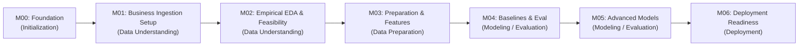

# Customer Purchase Propensity Prediction (T-ECD)

An end-to-end Machine Learning pipeline to predict 7-day customer purchase propensity in e-commerce using the **T-ECD (Taobao / E-Commerce Dataset)**, developed following the **CRISP-DM** methodology and engineered for execution on resource-constrained personal hardware.

---

## 1. Project Objective

In modern e-commerce, untargeted marketing promotions often erode gross margins (by discounting organic buyers) while irritating disengaged users. The objective of this project is to develop a production-ready, point-in-time correct Machine Learning pipeline that predicts:

$$\mathbb{P}(\text{Purchase within } (t_s, t_s + 7\text{ days}] \mid \text{Behavioral history up to } t_s)$$

for an active customer $u_i$ at snapshot time $t_s$.

This model enables:
- **Precision Promo Allocation**: Directing dynamic discount coupons exclusively to marginal customers whose purchase decision depends on an incentive.
- **Organic Margin Preservation**: Withholding discounts from high-propensity buyers who convert naturally at full price.
- **Engagement Optimization**: Triggering timely re-engagement notifications (e.g., cart abandonment nudges) while suppressing outbound marketing to disengaged accounts.

---

## 2. Dataset Selection & Resource Guardrails

- **Target Dataset**: **T-ECD (Taobao / E-Commerce Dataset)** Full version.
- **Interaction Data**: Large-scale user interaction logs comprising clicks (`pv`), favorites (`fav`), cart additions (`cart`), and purchases (`buy`).
- **Personal Laptop Resource Guardrails**:
  - Raw uncompressed e-commerce datasets typically span millions of interaction rows.
  - To enable fluid execution on a **16 GB RAM personal laptop**, the architecture relies on **Polars streaming/lazy execution**, columnar **Parquet** storage, and a **resource-efficient active user cohort sampling strategy** to be evaluated empirically during M02 and implemented in M03.
  - All empirical properties of the dataset (row counts, column definitions, temporal spans) remain pending direct inspection in M02.

---

## 3. CRISP-DM Methodology & Milestones

The project strictly follows the **Cross-Industry Standard Process for Data Mining (CRISP-DM)**, organized into seven staged milestones:



1. **M00 — Project Initialization & Foundation Setup**: Repository structure, data contracts, decision logs, personal-machine execution policies, and three-party governance protocols. *(CRISP-DM: Project Setup)*
2. **M01 — Data Acquisition, Environment Provisioning & Ingestion Setup**: Business definition of valid purchase, target objectives, preliminary customer eligibility policies, feature hypotheses, and safe raw ingestion mechanics. *(CRISP-DM: Data Understanding - Business Scoping & Ingestion Setup)*
3. **M02 — Exploratory Data Analysis & Empirical Data Quality Assessment**: Direct empirical schema inspection, event semantics and timestamp coverage validation, feature availability assessment, target constructibility verification, and sampling feasibility. *(CRISP-DM: Data Understanding - Empirical Exploration & Feasibility)*
4. **M03 — Data Preparation, Sampling Strategy & Feature Engineering**: Point-in-time snapshots, zero-leakage feature pipelines, and chronological splits with label maturity buffers. *(CRISP-DM: Data Preparation)*
5. **M04 — Baseline Modeling & Evaluation Strategy**: Ranking metrics (PR-AUC, P@K), calibration curves (Brier score), and heuristic/linear baselines. *(CRISP-DM: Modeling & Evaluation - Phase 1)*
6. **M05 — Advanced Modeling, Tuning & Error Analysis**: Gradient Boosted Decision Trees (LightGBM), hyperparameter optimization, SHAP interpretability, and cohort slicing. *(CRISP-DM: Modeling & Evaluation - Phase 2)*
7. **M06 — Deployment Readiness & Pipeline Packaging**: Automated batch scoring pipeline, data drift guards, integration testing, and delivery documentation. *(CRISP-DM: Deployment)*

---

## 4. Strict Repository Structure

To maintain high engineering hygiene, the repository root is restricted to exactly six components:

```text
PropensityVSF/
├── docs/               # All architectural, business, and operational documentation
│   ├── BUSINESS_UNDERSTANDING.md   # Business problem, use cases, and hypotheses
│   ├── DATA_CONTRACT.md            # Prediction unit, target horizon, leakage rules, temporal considerations
│   ├── DECISION_LOG.md             # 7 Approved decisions (AD-001–007), proposals, assumptions
│   ├── HANDOFF.md                  # Three-party governance exchange (Antigravity -> ChatGPT -> Project Owner)
│   ├── MILESTONE_CHECKLIST.md      # Objective exit criteria for M00-M06
│   ├── PROJECT_MASTER_PLAN.md      # Complete roadmap aligned with CRISP-DM
│   └── PROJECT_STATE.md            # Real-time state tracker and active milestone
├── notebooks/          # Exploratory data analysis and experimental notebooks
├── sample_data/        # Deterministic micro-samples for local unit testing
├── src/                # Modular, production-grade source code
├── pyproject.toml      # Standard Python project configuration (Python >= 3.12)
└── README.md           # Primary project documentation and orientation
```

*(`.git` directory is permitted as internal repository metadata store).*

---

## 5. Project Development Conventions

1. **Documentation Integrity**:
   - Any architectural or methodological change must be accompanied by an update to [docs/DECISION_LOG.md](file:///c:/Users/kienn/PropensityVSF/docs/DECISION_LOG.md) and [docs/PROJECT_STATE.md](file:///c:/Users/kienn/PropensityVSF/docs/PROJECT_STATE.md).
   - Assumptions must never be reported as verified facts until empirical evidence is logged in M02.
2. **Data Leakage Prohibition**:
   - Random train/test splits are strictly prohibited.
   - All dataset partitioning uses non-overlapping chronological boundaries ($T_{\text{train}} < T_{\text{val}} < T_{\text{test}}$) separated by label maturity buffers.
   - Feature calculations must only aggregate events where $t_{\text{event}} \le t_{\text{snapshot}}$.
3. **Environment & Dependency Management**:
   - Base runtime targets **Python 3.12**.
   - Routine non-destructive development operations (`git`, `uv`, `pip`, virtual environments, test executions) are authorized on personal hardware without per-step approval.
   - Virtual environments, package caches, and temporary artifacts must be stored outside the repository where practical to preserve the strict 6-component root structure.
   - Resource requirements must be assessed prior to large dataset downloads.
   - Lockfile generation is deferred until environment stabilization in M01.
4. **Code Quality Standards**:
   - All source code in `src/` must adhere to PEP 8 standards enforced via `ruff`.
   - Complex data transformations must be accompanied by automated unit tests or validation scripts.

---

## 6. Milestone Execution & Three-Party Governance Workflow

Project development utilizes a structured **three-party governance model**:

```mermaid
sequenceDiagram
    autonumber
    participant Antigravity as Antigravity (Implementation Engineer)
    participant Handoff as docs/HANDOFF.md
    participant ChatGPT as ChatGPT (Independent Reviewer)
    participant Owner as Project Owner (Final Authority)

    Antigravity->>Handoff: Complete milestone scope & local validation (Status: REVIEW_PENDING)
    ChatGPT->>Handoff: Conduct independent review against MILESTONE_CHECKLIST.md
    ChatGPT->>Handoff: Issue review recommendation (RECOMMEND_APPROVAL / RECOMMEND_REVISION / RECOMMEND_REJECT)
    Owner->>Handoff: Evaluate deliverables & ChatGPT recommendation; record final decision
    alt Project Owner Approves
        Owner->>Handoff: Approve milestone & authorize transition (Status: COMPLETED)
        Antigravity->>Handoff: Initialize next milestone
    else Project Owner Requests Revisions
        Owner->>Handoff: Specify mandatory remediation items (Status: IN_PROGRESS)
        Antigravity->>Handoff: Remediate issues and resubmit for review
    end
```

**Key Governance Rule**: ChatGPT provides independent review recommendations only. **The Project Owner has final approval authority.** Milestones will never be automatically marked `COMPLETED` based solely on ChatGPT's review output. Advancement to any subsequent milestone requires explicit Project Owner approval recorded in [docs/HANDOFF.md](file:///c:/Users/kienn/PropensityVSF/docs/HANDOFF.md).

---

## 7. Current Project Status

- **Active Milestone**: **`M00 — Project Initialization`**
- **Milestone Status**: **`REVIEW_PENDING`**
- **Last Updated**: 2026-11-05
- **Next Step**: Independent review recommendation by **ChatGPT** followed by final decision by the **Project Owner**.

For complete real-time tracking, refer to [docs/PROJECT_STATE.md](file:///c:/Users/kienn/PropensityVSF/docs/PROJECT_STATE.md).
