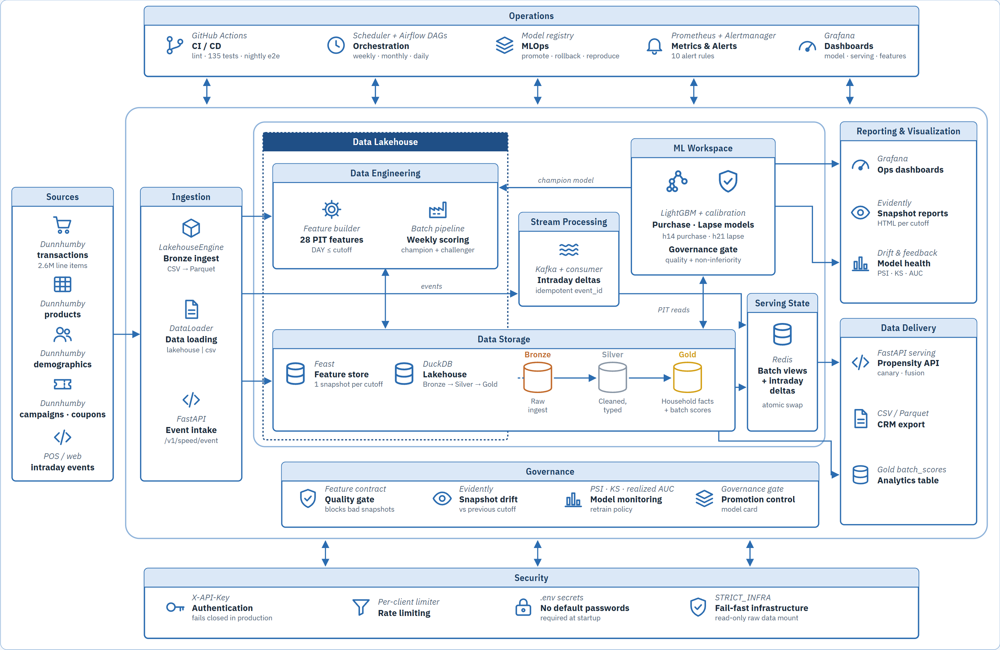
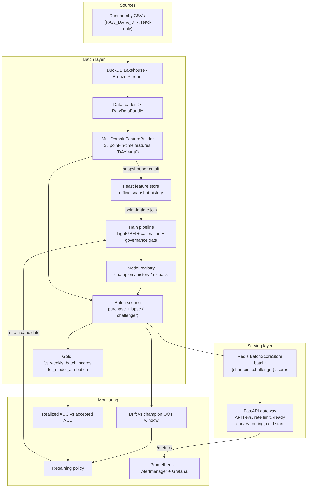

# Household Purchase Propensity Platform

End-to-end ML platform for household-level propensity scoring on Dunnhumby *"The Complete Journey"*
(2,500 households, 2.59M transactions, DAY 1–711).
- A **batch layer** trains point-in-time models and scores every household each week.
- A **serving layer** answers from those precomputed scores behind an authenticated FastAPI gateway.
- **Monitoring** compares drift and realized accuracy against what each champion was accepted with, and triggers retraining.

| Model | Question | OOT ROC-AUC | Lift@10% | Registry |
|---|---|---|---|---|
| `purchase` | ≥ 1 basket in the next 14 days (all households) | 0.859 | 1.42× (max 1.43×) | `models/` |
| `lapse` | regular shopper buys nothing in the next 21 days | 0.816 | 3.02× (max 9.4×) | `models/lapse/` |

- Both champions are **reproducible from this repo** (`python -m scripts.reproduce_champion`).
- Promotion requires a **governance gate**: base-rate-relative quality checks plus non-inferiority versus the active champion.

Read [docs/MODEL_CARD.md](docs/MODEL_CARD.md) before using the scores.

Documentation:
- [Model card](docs/MODEL_CARD.md): targets, data, metrics, limits.
- [Runbook](docs/RUNBOOK.md): jobs, retrain / promote / rollback, alert handling.
- [Target & business-value analysis](docs/analysis/TARGET_ANALYSIS.md).
- [Architecture diagrams](docs/architecture/ARCHITECTURE.md).

---

## 1. Architecture





Design rules that hold everywhere:
- **One feature contract** ([src/features/contract.py](src/features/contract.py)) and one feature code path, shared by training, batch scoring and the feature store. Parity is tested: CSV vs Lakehouse, and training rows vs batch rows.
- **Feature store as the training source:** every batch run appends its snapshot to the Feast
  offline history. Training reads features back through
  point-in-time joins, and cutoffs that were never snapshotted are backfilled once. Reads from the
  store are tested to equal recomputation. See [section 4.1](#41-feature-store).
- **One model definition** ([src/config/model_config.py](src/config/model_config.py)): target, horizon, temporal splits, hyper-parameters and gate. Every pipeline, DAG and the scheduler read it.
- **Self-describing bundles (schema v2):** target, feature set, horizon, cutoffs, data fingerprint and git SHA. The predictor refuses bundles that do not match the contract.

---

## 2. Repository Structure

```
├── docker-compose.yml        # Full stack (see section 3); .env.example lists the required secrets
├── Makefile                  # Shortcuts for the commands below
├── dags/                     # Airflow DAGs: weekly batch (+ drift), monthly retraining, feedback
├── docker/                   # Dockerfiles, Prometheus config + alert rules (+ promtool tests),
│                             # Alertmanager, Grafana provisioning
├── docs/                     # Model card, runbook, analysis, plan, architecture, CRISP-DM archive
├── models/                   # Tracked champions: purchase (root) and lapse/ (+ history/, ignored)
├── scripts/                  # reproduce_champion, registry CLI, target_analysis, load_test, e2e_smoke
├── src/
│   ├── config/               # settings.py (env), model_config.py (model definition + gates)
│   ├── data/                 # DataLoader: CSV or Lakehouse Bronze -> RawDataBundle
│   ├── features/             # contract, point-in-time extractor, targets (purchase / lapse)
│   ├── feature_store/        # Feast historical feature store (definitions from the contract, client)
│   ├── training/             # dataset builder, trainer, calibrators, evaluator, statistics,
│   │                         # champion/challenger comparison, model registry
│   ├── models/               # predictor (bundle validation, scoring, tiers)
│   ├── pipelines/            # train_pipeline, batch_pipeline
│   ├── serving/              # api, scoring service, batch store, canary router, security
│   ├── monitoring/           # drift, reference, feedback, retraining policy, state, metrics
│   ├── lakehouse/            # DuckDB medallion engine + data-quality checks
│   ├── scheduler/            # dependency-free cron daemon
│   └── common/               # logging, Redis connection factory
└── tests/                    # unit + pipeline tests on a synthetic fixture (tests/fixtures)
```

---

## 3. Quick Start

### Docker Compose (full stack)

```bash
cp .env.example .env     # set RAW_DATA_DIR (absolute path to the CSV folder), SERVING_API_KEYS,
                         # GRAFANA_ADMIN_PASSWORD; compose refuses to start without them
docker compose up -d --build                               # serving, scheduler, observability
docker compose --profile tools run --rm batch-pipeline     # first batch -> /ready turns 200
```

| Service | URL |
|---|---|
| Serving API | http://localhost:8000 (Swagger at `/docs`) |
| Prometheus / Alertmanager | http://localhost:9090 / http://localhost:9093 |
| Grafana | http://localhost:3000 (`admin` / `GRAFANA_ADMIN_PASSWORD`) |
| Redis | `localhost:6379` |

**End-to-end check:** `python -m scripts.e2e_smoke [--data real|synthetic]` builds the images and starts an isolated
compose project. It then runs batch scoring, training, feedback and predictions, checks Prometheus
and Alertmanager, and tears everything down. CI runs it nightly on synthetic data (`.github/workflows/e2e.yml`).

### Local development

```bash
pip install -e ".[dev]"
# Local runs without Redis need STRICT_INFRA=false (the default when no .env is present).

python -m src.pipelines.train_pipeline --target purchase --no-promote   # evaluate only
python -m src.pipelines.train_pipeline --target lapse                   # promote if the gate passes
python -m scripts.reproduce_champion --target purchase                  # |dAUC| <= 0.01 vs active champion
python -m scripts.registry --target purchase list                       # versions; rollback [--to V]
python -m scripts.target_analysis                                       # docs/analysis/TARGET_ANALYSIS.md
python -m src.pipelines.batch_pipeline --cutoff 711                     # scores + lapse list + drift audit
uvicorn src.serving.api:app --port 8000
```

---

## 4. Automated Scheduling & Production Orchestration

| Job | Schedule | Entry point | What it does |
|---|---|---|---|
| Weekly batch | Mon 02:00 UTC | `src.pipelines.batch_pipeline` | Bronze ingest, 28 PIT features (snapshot written to the feature store), score purchase (+ challenger) and lapse, Gold + Redis batch views, CRM / retention exports, drift audit (retrain if CRITICAL) |
| Monthly retraining | 1st of month 03:00 UTC | `src.pipelines.train_pipeline` (both targets) | Train, calibrate, evaluate OOT, governance gate, atomic promotion, serving hot-reload |
| Daily data quality | 01:00 UTC | `LakehouseEngine.run_data_quality_framework` | Row counts, negative values, household coverage |
| Weekly feedback | Wed 04:00 UTC | `GroundTruthFeedbackLoop` | Realized AUC per target on the latest matured cutoff, retrain if degraded |

### 4.1 Feature store

| | |
|---|---|
| Location | `FEATURE_STORE_DIR` (default `data/feature_store`; in docker `/app/data/lakehouse/feature_store`) |
| Offline | `offline/household_features.parquet`: one snapshot per cutoff, appended atomically (re-writing a cutoff replaces it) |
| Online | None. Serving uses precomputed batch scores in Redis, not live features |
| Schema | Generated from the feature contract: 21 `Float64` + 7 `String`. View `household_features_multidomain_v1`, entity `household_key` |
| Timeline | `DAY d` -> `2026-01-01 + d days` (UTC); TTL = `FEATURE_TTL_DAYS` (7). A read more than 7 days after the last snapshot fails instead of returning stale values |
| Registry | Applied from code (`FeatureStoreClient.apply()`); no `feast apply` step |
| Quality gate | `src/features/quality.py`, run before a snapshot is stored or scored: value ranges, known categories, window consistency (14d <= 30d <= ... counts and spends), one row per household, no loss of > 10% of households and no zero-share jump > 25 points vs the previous snapshot. A failing snapshot is not written and the batch stops (even without `STRICT_INFRA`). Switch: `FEATURE_QUALITY_CHECKS` |
| Observability | `src/feature_store/observability.py` ([Evidently](https://github.com/evidentlyai/evidently), extra `observability`). Every batch profiles its snapshot against the previous one: per-feature drift (normed Wasserstein / Jensen-Shannon, drift at >= 0.1), share of values outside the previous [min, max], constant columns, summary statistics. Writes `reports/feature_store/snapshot_<day>.html` (interactive) + `.json`, and publishes gauges to Grafana (row *Feature Store*). Observes only, never blocks. Switch: `FEATURE_STORE_PROFILING` |

```bash
python -m scripts.feature_store status                 # snapshots in the history
python -m scripts.feature_store backfill --training    # all fit/val/test cutoffs of both targets
python -m scripts.feature_store history --household 1  # PIT values at every snapshot
python -m scripts.feature_store profile --cutoff 711   # Evidently HTML report vs the previous snapshot
python -m scripts.feature_store profile --all --no-html && python -m scripts.feature_store trend --feature spend_90d
python -m src.pipelines.train_pipeline --feature-source builder   # bypass the store (recompute)
```

There are two ways to run these jobs:
- **Dependency-free scheduler** (`src/scheduler/daemon.py`, compose service `scheduler`): run a single job with `--run-job batch|retrain|dq|feedback`.
- **Airflow DAGs** in `dags/`: same jobs, same configuration.

Day-to-day operation is described in [docs/RUNBOOK.md](docs/RUNBOOK.md).

### Monitoring loop

| Signal | Produced by | Reference | Action |
|---|---|---|---|
| Feature and prediction drift (PSI / KS) | Batch pipeline, every run | The champion's own out-of-time test window (bundle `test_cutoffs`) | CRITICAL starts an out-of-cycle retraining |
| Realized AUC | Feedback job, latest cutoff with matured labels | The AUC the champion was accepted with | Drop > `REALIZED_AUC_DROP_ALERT` (0.05) starts a retraining |

- **Retraining:** a triggered retraining only produces a *candidate*. Promotion still goes through the governance gate. Set `AUTO_RETRAIN_ON_DEGRADATION=false` to only alert.
- **Getting reports to Prometheus:** the batch and feedback jobs run in their own processes. They publish their reports to `MonitoringState` (Redis, plus a JSON file), and the serving API turns them into gauges on every `/metrics` scrape.
- **Alerts:** defined in `docker/prometheus/alert_rules.yml` (drift, realized AUC drop, feature snapshot rejected by the quality gate, snapshot-to-snapshot drift > 25% of features, out-of-range values > 5%, p99 latency, missing batch view, serving down) and routed by Alertmanager (`docker/alertmanager.yml`, port 9093). The rules are unit-tested with `promtool test rules docker/prometheus/alert_rules_test.yml` in CI.

```bash
python -m src.scheduler.daemon --run-job feedback   # realized AUC for purchase + lapse, retrain if degraded
```

---

## 5. REST API Reference

The Serving API answers from the precomputed weekly batch views. The served probability is exactly the
champion's batch score, so drift, realized AUC and the model card describe what clients receive.

**Where batch scores come from.** `src.pipelines.batch_pipeline` publishes each run to the shared
`BatchScoreStore`: a Redis hash per variant (champion / challenger), swapped in atomically with `RENAME`,
so every replica serves the same snapshot. Without Redis, the API loads the newest
`data/outputs/batch_manifest_day_*.json` artefacts at start-up.

**Security.**
- Protected endpoints require `X-API-Key` with a key from `SERVING_API_KEYS`:
  `POST /v1/canary/config`, `GET /v1/batch/scores` and `POST /v1/models/reload`.
- With no keys configured, these endpoints are open in development and return `503` in production.
- Predictions are rate-limited per client (`RATE_LIMIT_PER_MINUTE`).
- `STRICT_INFRA=true` disables every in-memory fallback, so the service fails fast if Redis is down.

| Endpoint | Auth | Purpose |
|---|---|---|
| `GET /health` | – | Liveness: champion bundle, target, horizon, batch-view status |
| `GET /ready` | – | Readiness: `503` until champion batch scores are loaded |
| `POST /v1/predict/propensity` | – | Propensity for one household |
| `GET /v1/batch/scores` | key | Bulk export of batch views (`decile`, `limit`, `variant`) |
| `GET /v1/canary/config` / `POST` | – / key | Read / change the champion-challenger split |
| `GET /v1/models/champion` | – | Active champion contract |
| `POST /v1/models/reload` | key | Hot-reload the champion from the registry |
| `GET /metrics`, `GET /v1/metrics` | – | Prometheus / JSON metrics |

### Predict
```bash
curl -X POST http://localhost:8000/v1/predict/propensity \
  -H "Content-Type: application/json" -d '{"household_key": 100}'
```
```json
{
  "household_key": 100,
  "propensity": 0.885,
  "decile": 9,
  "urgency_tier": "URGENT",
  "marketing_action": "VIP_COUPON_HALO_UPSELL",
  "model_variant": "champion",
  "routed_variant": "champion",
  "score_source": "batch",
  "batch_snapshot_day": 711
}
```

`score_source` tells you where the score came from:
- `batch`: the household's batch view.
- `cold_start`: the household has no batch view. The score is the population mean of the latest batch
  (or the champion's test base rate), `decile` is `null` and the action is `COLD_START_DEFAULT`.

`routed_variant` is the canary assignment, and `model_variant` is the batch view actually served. These
differ when the challenger has no published scores yet; the champion view is served instead.

### Batch export, canary, reload
```bash
curl -H "X-API-Key: $SERVING_API_KEY" "http://localhost:8000/v1/batch/scores?decile=10&limit=50"

# Challenger must predict the same target / horizon / feature set as the champion.
# Score it in the batch layer (CHALLENGER_MODEL_PATH or --challenger) so routed traffic gets its own view.
curl -X POST http://localhost:8000/v1/canary/config -H "Content-Type: application/json" \
  -H "X-API-Key: $SERVING_API_KEY" \
  -d '{"challenger_ratio": 0.20, "challenger_model_path": "/app/models/challenger_model.joblib"}'

curl -X POST -H "X-API-Key: $SERVING_API_KEY" http://localhost:8000/v1/models/reload
```

### Load test
`python -m scripts.load_test` starts uvicorn, waits for `/ready` and reports p50 / p95 / p99. The Phase 4
target is predict p99 < 50 ms. Measured locally with one worker, the memory backend and the client on the
same machine:

| Concurrency | p50 | p95 | p99 |
|---|---|---|---|
| 16 | 26.2 ms | 42.3 ms | 47.3 ms |
| 4 | 8.5 ms | 30.6 ms | 31.9 ms |

---

## 6. Testing & Verification

```bash
ruff check .                               # pinned rule set (pyproject)
python -m pytest                           # everything (real-data tests self-skip without the CSVs)
python -m pytest -m "not integration"      # what CI runs on every PR
python -m scripts.e2e_smoke                # docker-compose end-to-end (nightly in CI on synthetic data)
python -m scripts.load_test                # serving latency p50/p95/p99
```

Markers: `requires_data` (skips itself when the Dunnhumby CSVs are absent). Every test gets its own
empty feature store. Pipeline tests use the synthetic Dunnhumby-shaped fixture in `tests/fixtures/`, so they
run in seconds without real data.

| Area | Tests |
|---|---|
| Features & data | `test_feature_contract.py` (PIT correctness, CSV vs Lakehouse parity, train vs batch parity), `test_lakehouse.py` |
| Training & governance | `test_training_pipeline.py`, `test_governance.py` (gate, paired bootstrap, champion/challenger, atomic promotion, rollback), `test_targets.py` (purchase / lapse, value-ranked retention list), `test_predictor.py` (bundle validation) |
| Serving | `test_serving_api.py` (auth 401/503, rate limit 429, cold start, canary variants, streaming endpoint removed), `test_serving_infra.py` (Redis batch store, STRICT_INFRA, challenger scoring), `test_canary_routing.py`, `test_lambda_fusion.py`, `test_kafka_bus.py` |
| Feature store | `test_feature_store.py` (append-only history, PIT reads equal the builder, TTL, training and batch through the store), `test_feature_quality.py` (each quality check, store refuses and batch stops on a bad snapshot), `test_feature_store_observability.py` (Evidently profile, injected shift detected, trends, gauges, profiling never blocks the batch) |
| Monitoring & orchestration | `test_feedback_loop.py` (realized AUC, simulated drift -> retraining, gauges), `test_monitoring.py`, `test_scheduler.py` |
| Alerting | `docker/prometheus/alert_rules_test.yml` (`promtool test rules`, in CI) |

---

## 7. Cloud Migration Strategy

Storage and compute are decoupled, so the stack can move to GCP or AWS component by component:

| Component | On-premise | GCP | AWS | Method |
|---|---|---|---|---|
| Raw / master data | Read-only CSV mount (`RAW_DATA_DIR`) | Cloud Storage | S3 | Copy once; point `DATA_RAW_DIR` at the mounted bucket |
| Lakehouse | DuckDB + Parquet | BigQuery | Snowflake / Redshift | Re-implement `LakehouseEngine` Bronze reads; the `DataLoader` contract is unchanged |
| Serving state | Redis 7 | Memorystore | ElastiCache | Redis replication, then a DNS switch |
| Serving / pipelines | Docker images | GKE | EKS | Same images; blue/green cutover gated by `/ready` |

---

## 8. Known Limitations

- **Not causal.** Scores rank households and do not measure campaign uplift. At a 14-day horizon, top-decile
  purchase households would mostly buy anyway.
- **Scores refresh weekly.** A household that bought today keeps its score until the next batch; suppress
  recent buyers in the campaign tool if that matters.
- **Rate limiting is per process.** Enforce a global limit at the gateway.

---

## 9. License
Proprietary & Confidential - Built for Enterprise Household Purchase Propensity Scoring.
