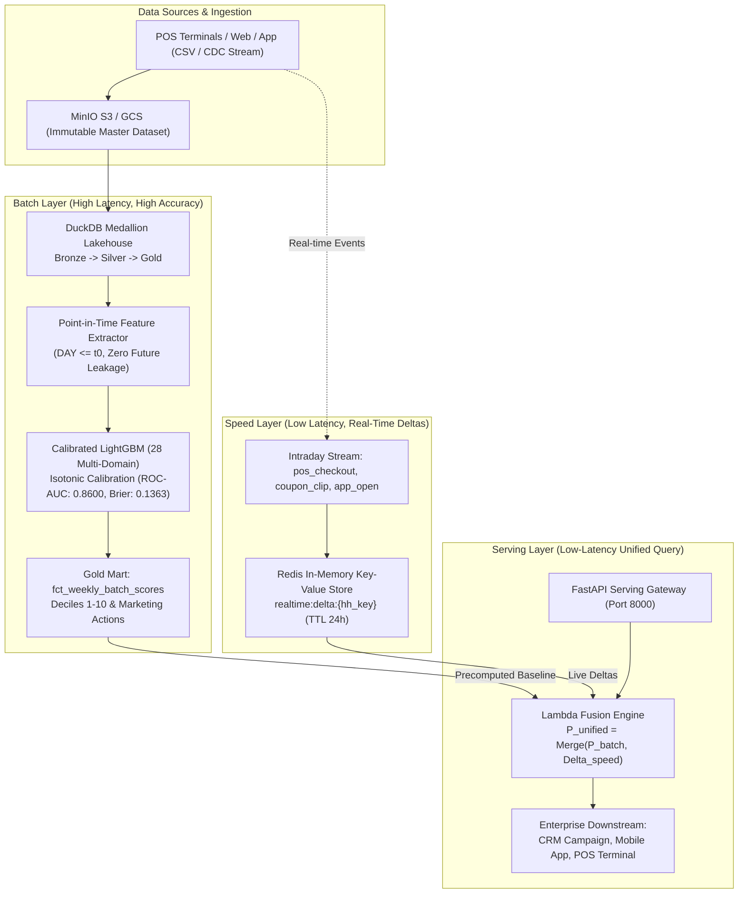

# Enterprise Lambda Architecture: Household Purchase Propensity Platform

An end-to-end Enterprise Machine Learning system designed for household purchase propensity scoring on retail datasets (Dunnhumby *"The Complete Journey"* - 2,500 households, 2.59M transactions, 711 days).

Built with a strict **Lambda Architecture** (Batch Layer, Speed Layer, Serving Layer) to satisfy high-accuracy historical propensity while reacting within milliseconds to intraday shopping events. Designed **On-Premise first** with a **Zero-Downtime Cloud Migration Strategy** to AWS / GCP.

---

## 1. High-Level Architecture

The platform separates long-term lookback feature extraction from real-time intraday events, unifying them at inference time:



### Visual Excalidraw Diagram
- Interactive Excalidraw blueprint: [`docs/architecture/lambda_architecture.excalidraw`](file:///c:/Users/kienn/PropensityVSF/docs/architecture/lambda_architecture.excalidraw)
- Detailed Technical Specification: [`docs/architecture/LAMBDA_ARCHITECTURE_ONPREM_TO_CLOUD.md`](file:///c:/Users/kienn/PropensityVSF/docs/architecture/LAMBDA_ARCHITECTURE_ONPREM_TO_CLOUD.md)

---

## 2. Repository Structure

```
PropensityVSF/
├── docker-compose.yml              # On-premise infrastructure orchestration
├── pyproject.toml                  # Modern Python packaging & dependencies
├── .env.example                    # Template environment variables
├── docker/
│   ├── Dockerfile.serving          # Multi-stage production container for FastAPI Serving
│   ├── Dockerfile.pipeline         # Container for Lakehouse ETL, training & batch scoring
│   └── minio_init.sh               # MinIO S3 bucket provisioning script
├── dags/
│   ├── dag_weekly_batch_propensity.py    # Apache Airflow / Cloud Composer DAG for weekly batch scoring
│   └── dag_monthly_model_retraining.py  # Apache Airflow DAG for monthly retraining & hot-reload
├── docs/
│   └── architecture/
│       ├── LAMBDA_ARCHITECTURE_ONPREM_TO_CLOUD.md  # Master architectural specification
│       └── lambda_architecture.excalidraw          # Interactive Excalidraw visual diagram
├── models/
│   ├── champion_model.joblib       # Active Champion LightGBM bundle (28 features, Isotonic calibrated, AUC: 0.8600)
│   ├── latest_model_manifest.json  # Manifest with metrics, validation scores & cutoffs
│   └── history/                    # Timestamped archives of promoted champion models
├── src/
│   ├── common/
│   │   └── logger.py               # Enterprise logging configuration
│   ├── config/
│   │   └── settings.py             # Pydantic v2 type-safe settings & environment validation
│   ├── features/
│   │   └── pit_extractor.py        # Point-in-Time feature extractor (strictly DAY <= t0)
│   ├── lakehouse/
│   │   └── engine.py               # DuckDB Parquet Medallion Lakehouse & DQ Framework
│   ├── models/
│   │   └── predictor.py            # Champion model predictor, decile & urgency assignment
│   ├── pipelines/
│   │   ├── batch_pipeline.py       # Weekly batch scoring pipeline runner
│   │   └── train_pipeline.py       # Automated Retraining & Model Promotion pipeline runner
│   ├── scheduler/
│   │   └── daemon.py               # Automated Scheduler Daemon (zero-dependency cron orchestrator)
│   ├── serving/
│   │   ├── api.py                  # FastAPI REST microservice endpoints
│   │   └── fusion_engine.py        # Lambda Serving Fusion Engine (P_batch + Delta_speed)
│   ├── speed_layer/
│   │   └── delta_stream.py         # Real-time event ingestion & Redis delta management
│   └── training/
│       ├── dataset_builder.py      # Multi-cutoff temporal training data & target generator
│       ├── trainer.py              # LightGBM classifier & baseline Logistic Regression trainer
│       ├── calibrator.py           # Platt scaling (logistic on logit) probability calibrator
│       ├── evaluator.py            # Metrics (ROC-AUC, Brier score, Log loss, Lift@10%)
│       └── model_registry.py       # Champion/Challenger quality gates & model bundle packager
└── tests/
    ├── test_features_pit.py        # Point-in-Time leakage & feature boundary tests
    ├── test_lakehouse.py           # Bronze/Silver/Gold Lakehouse & Data Quality tests
    ├── test_lambda_fusion.py       # Lambda Serving fusion rules unit tests
    ├── test_scheduler.py           # Scheduler daemon, triggers & Airflow DAGs tests
    ├── test_serving_api.py         # FastAPI REST endpoint & hot-reload integration tests
    └── test_training_pipeline.py   # Training, calibration, evaluator & registry gate tests
```

---

## 3. Quick Start

### Option A: Complete Docker Compose Stack (Recommended)

Start PostgreSQL 16 (OLTP), MinIO S3 (Lakehouse Master), Redis 7 (Speed/Serving Cache), FastAPI Serving API, and Batch Pipeline Runner:

```bash
# 1. Copy environment template
cp .env.example .env

# 2. Build and launch all services
docker compose up -d

# 3. View service status
docker compose ps
```

Service URLs:
- **FastAPI Serving API**: [http://localhost:8000](http://localhost:8000) (Swagger UI: [http://localhost:8000/docs](http://localhost:8000/docs))
- **MinIO S3 Console**: [http://localhost:9001](http://localhost:9001) (User: `minioadmin` / `minioadmin`)
- **PostgreSQL OLTP**: `localhost:5432` (`propensity_oltp`)
- **Redis Cache**: `localhost:6379`

### Option B: Local Development Environment

```bash
# 1. Install dependencies
pip install -e .

# 2. Train Champion LightGBM model across temporal cutoffs (with Platt calibration & governance gates)
python -m src.pipelines.train_pipeline --train-cutoffs 300,400 --val-cutoff 537

# 3. Run the weekly batch scoring pipeline
python -m src.pipelines.batch_pipeline --cutoff 711

# 4. Start the FastAPI Serving Gateway
uvicorn src.serving.api:app --host 0.0.0.0 --port 8000 --reload
```

---

## 4. Automated Scheduling & Production Orchestration

The platform provides dual-track scheduling designed for both standalone on-premise execution and managed cloud environments (Google Cloud Composer / AWS MWAA):

| Pipeline Job | Production Schedule | Orchestration Target | Description |
|---|---|---|---|
| **Weekly Batch Scoring** | Every Monday at 02:00 UTC (`0 2 * * 1`) | `src.pipelines.batch_pipeline` | Ingests new POS data, extracts 28 Point-in-Time features, scores 2,500 households, updates Gold Lakehouse mart, exports CRM audience, and clears intraday deltas. |
| **Monthly Model Retraining** | 1st of month at 03:00 UTC (`0 3 1 * *`) | `src.pipelines.train_pipeline` | Builds multi-cutoff temporal training data, retrains LightGBM candidate, evaluates governance quality gates (ROC-AUC $\ge$ 0.85, Lift $\ge$ 1.30x), registers champion, and calls webhook to hot-reload serving. |
| **Daily Data Quality Audit** | Every day at 01:00 UTC (`0 1 * * *`) | `LakehouseEngine.run_data_quality_framework` | Verifies row counts, checks for negative pricing/quantity anomalies, validates temporal bounds, and ensures schema conformity. |

### Track 1: Lightweight Scheduler Daemon (On-Premise / Docker Compose)
Implemented with zero external dependencies in `src.scheduler.daemon.py`. Integrated directly into `docker-compose.yml` under the `scheduler` service:

```bash
# Run scheduler daemon locally (polls every 30s)
python -m src.scheduler.daemon --poll-interval 30 --serving-url http://localhost:8000

# Execute all jobs immediately once (smoke testing / verification)
python -m src.scheduler.daemon --run-once-all

# Execute a single on-demand job (batch | retrain | dq)
python -m src.scheduler.daemon --run-job batch

# Launch within Docker Compose
docker compose up -d scheduler
```

### Track 2: Enterprise Apache Airflow / Google Cloud Composer DAGs
Production-ready Airflow DAGs located in `dags/` featuring automatic retry policies, XCom parameter passing, and cross-platform fallbacks:
- `dags/dag_weekly_batch_propensity.py`: Orchestrates weekly batch scoring, Lakehouse sync, and marketing segment materialization.
- `dags/dag_monthly_model_retraining.py`: Orchestrates model retraining, governance verification, and calls `POST /v1/models/reload` on the FastAPI Serving Gateway for **zero-downtime hot-reloading** of the model bundle in memory.

---

## 5. REST API Reference

The Serving API provides low-latency inference fusing weekly batch scores with intraday streaming deltas:

### 1. Health & Readiness Probe
```bash
curl -X GET http://localhost:8000/health
```
**Response:**
```json
{
  "status": "HEALTHY",
  "service": "propensity-serving-api",
  "environment": "development",
  "model_bundle": "28 multi-domain (projectphase3)",
  "feature_count": 28
}
```

### 2. Inspect Active Champion Model & Zero-Downtime Hot-Reload
```bash
# View active Champion model contract and features
curl -X GET http://localhost:8000/v1/models/champion

# Hot-reload newly trained Champion Model into memory without restarting API
curl -X POST http://localhost:8000/v1/models/reload
```
**Response:**
```json
{
  "status": "RELOADED",
  "active_bundle": "28 multi-domain (projectphase3)",
  "feature_count": 28
}
```

### 3. Predict Real-Time Unified Propensity
```bash
curl -X POST http://localhost:8000/v1/predict/propensity \
  -H "Content-Type: application/json" \
  -d '{"household_key": 100}'
```
**Response:**
```json
{
  "household_key": 100,
  "unified_propensity": 0.885,
  "batch_baseline_propensity": 0.885,
  "decile": 9,
  "urgency_tier": "URGENT",
  "marketing_action": "VIP_COUPON_HALO_UPSELL",
  "intraday_delta": {
    "intraday_trips_detected": 0,
    "intraday_coupons_clipped": 0,
    "intraday_spend": 0.0
  },
  "applied_fusion_rules": []
}
```

### 3. Ingest Streaming Speed Event
When a customer completes a POS checkout or clips a coupon in the mobile app:
```bash
curl -X POST http://localhost:8000/v1/speed/event \
  -H "Content-Type: application/json" \
  -d '{
    "household_key": 100,
    "event_type": "pos_checkout",
    "sales_value": 78.50
  }'
```
**Immediate Dynamic Effect:**
The next call to `/v1/predict/propensity` for household 100 instantly applies the **Intraday Purchase Dampening Rule** ($P_{\text{unified}} = P_{\text{batch}} \times 0.25$), switching the urgency tier to `LOW` and marketing action to `POST_PURCHASE_COOLDOWN`, preventing redundant marketing spend.

### 4. Query Batch Scores
```bash
# Retrieve top Decile 10 households for upcoming campaign
curl -X GET "http://localhost:8000/v1/batch/scores?decile=10&limit=50"
```

---

## 6. Automated Testing & Verification

The test suite validates data quality, point-in-time leakage prevention, speed-batch fusion logic, scheduler triggers, Airflow DAGs, and API endpoints:

```bash
# Run complete test suite
python -m pytest tests/ -v
```

**Test Coverage Summary:**
1. `tests/test_features_pit.py`: Validates strictly $DAY \le t_0$, zero future leakage, and correct feature computation across 2,500 households.
2. `tests/test_lakehouse.py`: Validates Bronze Parquet conversion, Silver star schema views, Gold marts, and automated Data Quality assertions.
3. `tests/test_lambda_fusion.py`: Validates the mathematical rules of the Serving Layer (intraday dampening, coupon intent surge, app nudge).
4. `tests/test_scheduler.py`: Validates `ScheduledTask` triggers (interval, daily, weekly, monthly), scheduler execution, and Apache Airflow DAG structures.
5. `tests/test_serving_api.py`: Validates all FastAPI endpoints (`/health`, `/v1/predict/propensity`, `/v1/speed/event`, `/v1/batch/scores`, `/v1/metrics`, `/v1/models/champion`, `/v1/models/reload`).
6. `tests/test_training_pipeline.py`: Validates dataset building, target prospective labeling, LightGBM training, Platt calibration, evaluation metrics, and Model Registry governance quality gates.

---

## 7. Zero-Downtime Cloud Migration Strategy

The system is designed with strict storage and compute decoupling, enabling a phased, zero-downtime migration to GCP or AWS:

| Component | On-Premise Stack | GCP Migration Target | AWS Migration Target | Migration Method |
|---|---|---|---|---|
| **Master Dataset** | MinIO (S3 API) | Google Cloud Storage (GCS) | Amazon S3 | `rclone` / Storage Transfer Service (Active-Active) |
| **Lakehouse Engine** | DuckDB + Parquet | Google BigQuery | Snowflake / Redshift | `dbt-bigquery` adapter swap; zero SQL rewrite |
| **Streaming / Speed** | Redis 7 + In-Memory | Google Cloud Memorystore | Amazon ElastiCache Redis | Redis replication or dual-write from gateway |
| **Event Bus** | Kafka / Direct REST | Cloud Pub/Sub | Amazon Kinesis / MSK | MirrorMaker 2 (Zero loss) |
| **Serving API** | FastAPI on Docker | Google Kubernetes Engine (GKE) | Amazon EKS | Identical Docker images; Blue/Green DNS cutover |

For complete rollback criteria, data validation checks, and operational runbooks, see [`docs/architecture/LAMBDA_ARCHITECTURE_ONPREM_TO_CLOUD.md`](file:///c:/Users/kienn/PropensityVSF/docs/architecture/LAMBDA_ARCHITECTURE_ONPREM_TO_CLOUD.md).

---

## 8. License
Proprietary & Confidential - Built for Enterprise Household Purchase Propensity Scoring.
