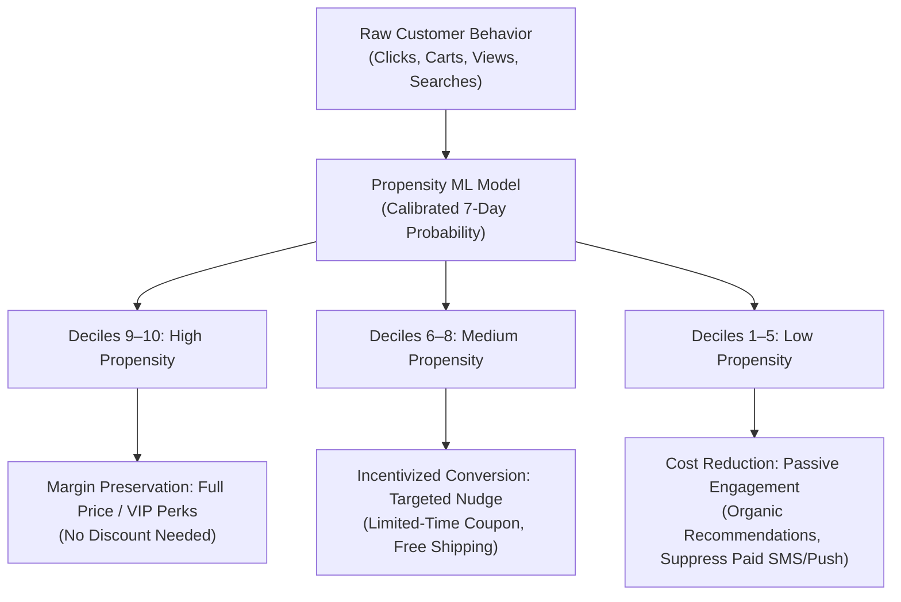

# Business Understanding: Customer Purchase Propensity Prediction

## 1. Executive Summary & Business Problem

In competitive e-commerce environments, customer acquisition costs continue to escalate while customer retention and conversion rates remain challenging. Traditional marketing strategies frequently rely on blanket promotions, static email blasts, or untargeted discount codes. These approaches suffer from two primary drawbacks:
1. **Margin Erosion**: Offering unnecessary discounts to high-intent shoppers who would have purchased at full price anyway.
2. **Customer Fatigue & Churn**: Bombarding low-propensity or disengaged shoppers with irrelevant notifications, accelerating opt-outs and app uninstalls.

The objective of this project is to develop an **ML-driven Customer Purchase Propensity Prediction System** using the **T-ECD (Taobao / E-Commerce Dataset)**. By accurately estimating the probability that an active customer will complete at least one purchase within the next **7 days**, business stakeholders can replace blunt marketing tactics with high-precision, value-maximizing interventions.

---

## 2. Business Value Proposition & Economic Impact

1. **Optimized Promotion Spend**: Allocate promotional budgets (e.g., dynamic discount vouchers, subsidized shipping) exclusively to marginal shoppers (medium propensity) who require an incentive to convert, while withholding discounts from organic buyers.
2. **Reduced Communication Costs**: Suppress expensive SMS and outbound marketing messages to customers with near-zero conversion intent, cutting direct messaging expenditure.
3. **Enhanced Customer Experience**: Present personalized product recommendations and timely reminders (e.g., abandoned cart re-engagement) when purchase interest is peaking.

---

## 3. Concrete Potential Use Cases

| Use Case | Description | Target Segment | Intervention Mechanism |
| :--- | :--- | :--- | :--- |
| **UC-1: Dynamic Coupon Allocation** | Distribute 10% discount codes only to customers on the conversion boundary. | Medium Propensity (e.g., Deciles 6–8) | Automated CRM coupon injection valid for 48 hours. |
| **UC-2: VIP Experience & Cross-Sell** | Prioritize high-margin product discovery and loyalty rewards without margin-eroding discounts. | High Propensity (e.g., Deciles 9–10) | Homepage banner personalization; dedicated concierge support. |
| **UC-3: Cart Abandonment Nudge** | Trigger timely push notification or email reminder when a user adds items to cart but delays checkout. | High-Medium Propensity with active cart | Push notification sent 12–24 hours post-session. |
| **UC-4: Ad Retargeting Suppression** | Exclude users with extremely low or guaranteed high propensity from paid display ad retargeting campaigns. | Deciles 1–3 and Decile 10 | Real-time audience sync with DSP/Ad Networks to eliminate wasted ad spend. |

---

## 4. Key Stakeholder Questions & KPIs

### Stakeholder Questions
- **Marketing Director**: *"Can we identify the exact customer segment where a 5% discount generates incremental revenue without subsidizing organic conversions?"*
- **CRM Manager**: *"How accurately can we rank customers each Monday morning to prioritize our weekly promotional newsletter?"*
- **E-Commerce Merchandiser**: *"Does customer propensity differ significantly across product categories (e.g., fast fashion vs. electronics)?"*
- **ML Operations / Tech Lead**: *"Can this model be trained, validated, and run in batch inference reliably on standard hardware with strict data hygiene?"*

### Primary Metrics & KPIs

| Metric Type | Metric Name | Definition & Target |
| :--- | :--- | :--- |
| **Business KPI** | **Incremental Conversion Lift** | Difference in purchase conversion rate between targeted treatment group and holdout control group. |
| **Business KPI** | **Promotion ROI / Margin Preservation** | Net margin generated per promotional dollar spent; reduction in discount cannibalization. |
| **Business KPI** | **Communication Cost Reduction** | Percentage reduction in marketing SMS/Email sends without drop in total order volume. |
| **ML Evaluation** | **PR-AUC (Precision-Recall AUC)** | Area under the Precision-Recall curve; primary ranking metric for imbalanced conversion data. |
| **ML Evaluation** | **Precision@Top-Decile (P@10%)** | Fraction of customers in the highest predicted decile who actually convert within 7 days. |
| **ML Evaluation** | **Brier Score / Calibration Error** | Mean squared difference between predicted probabilities and actual binary outcomes; ensures reliable probability thresholds. |

---

## 5. Initial Domain Hypotheses

| Hypothesis ID | Feature Domain | Domain Hypothesis | Preliminary Validation Path |
| :--- | :--- | :--- | :--- |
| **HYP-001** | **Recency** | Customers who interacted with the platform within the last 24 to 72 hours exhibit exponentially higher purchase propensity than those inactive for > 7 days. | Compute purchase conversion rate grouped by days since last interaction in M02. |
| **HYP-002** | **Funnel Depth** | Adding an item to the shopping cart or marking an item as favorite is a significantly stronger purchase indicator than raw item clicks or impressions. | Compare conversion rate conditional on cart addition vs click-only sessions in M02. |
| **HYP-003** | **Session Intensity** | High frequency of item views concentrated in a single category within a short observation window signals immediate purchasing intent. | Engineer category concentration and session event velocity features in M03. |
| **HYP-004** | **Temporal Cyclicity** | Purchase propensity peaks on specific days of the week (e.g., weekends or paydays) and hours of the day (e.g., evening leisure hours). | Analyze temporal volume and conversion rates across weekday/hour buckets in M02. |
| **HYP-005** | **Historical Frequency** | Repeat historical purchasers have a fundamentally different baseline conversion rate than first-time visitors, requiring dedicated historical interaction features. | Analyze purchase rate split by historical order count in M02/M03. |

---

## 6. Operational Constraints & Environmental Boundaries

1. **Compute Environment**: Must be capable of development, exploratory analysis, feature extraction, and model training on a **personal laptop** (16 GB RAM, multi-core CPU, limited local storage).
2. **Inference Cadence**: Batch inference architecture (e.g., weekly or daily scoring). Real-time streaming inference is out of scope for initial milestones.
3. **Data Freshness & Leakage**: All predictive signals must reflect information strictly available prior to the prediction timestamp ($t \le t_{\text{snapshot}}$).

