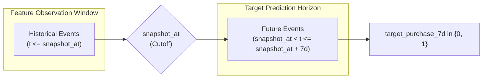

# Data Contract: Customer Purchase Propensity Prediction

## 1. Specification Overview

This Data Contract establishes the mathematical and architectural definitions for modeling datasets, feature sets, target definitions, and temporal constraints for the Customer Purchase Propensity ML pipeline. All downstream ingestion, preparation, and modeling steps must adhere strictly to these contract rules.

---

## 2. Prediction Unit & Entity Definition

- **Primary Entity**: Active Customer / User (`user_id`).
- **Prediction Unit**: Composite key **`(user_id, snapshot_at)`**, where:
  - `user_id`: Unique identifier representing an individual consumer account.
  - `snapshot_at`: Exact point in time (timestamp) at which the prediction is generated.
- **Granularity**: Exactly one record per `(user_id, snapshot_at)` pair in any prepared training, validation, testing, or inference dataset.

---

## 3. Target Variable Specification

| Property | Definition |
| :--- | :--- |
| **Field Name** | `target_purchase_7d` |
| **Data Type** | `int8` (Binary: `0` or `1`) |
| **Prediction Horizon** | Exactly **7 calendar days** (168 hours) post-snapshot: `(snapshot_at, snapshot_at + 7 days]`. |
| **Positive Class (`1`)** | Customer completes at least one confirmed purchase event during the 7-day prediction window: $\sum_{t \in (\text{snapshot\_at}, \text{snapshot\_at} + 7d]} \mathbb{I}(\text{event} = \text{purchase}) \ge 1$. |
| **Negative Class (`0`)** | Customer completes zero purchases during the 7-day prediction window: $\sum_{t \in (\text{snapshot\_at}, \text{snapshot\_at} + 7d]} \mathbb{I}(\text{event} = \text{purchase}) = 0$. |
| **Handling Returns/Cancellations** | Pending validation of raw T-ECD dataset in M01/M02. If cancellations are absent, all recorded purchase events are treated as completed conversions. |

---

## 4. Temporal Boundaries & Anti-Leakage Constraints

### Strict Temporal Separation Rules
1. **Zero Future Information in Features**:
   - For any record with snapshot timestamp $t_s = \text{snapshot\_at}$, feature values $X(u, t_s)$ must be computed strictly from events where event timestamp $t_{\text{event}} \le t_s$.
   - Any feature calculation using $t_{\text{event}} > t_s$ is classified as a critical defect (lookahead leakage) and will fail the automated validation suite.
2. **Chronological Dataset Partitioning**:
   - Random train/test splits (e.g., standard random `train_test_split`) are strictly prohibited.
   - Splits must be non-overlapping chronological intervals:
     - **Training Set**: Snapshots taken in $[T_{\text{train\_start}}, T_{\text{train\_end}}]$
     - **Validation Set**: Snapshots taken in $[T_{\text{val\_start}}, T_{\text{val\_end}}]$ where $T_{\text{train\_end}} + 7\text{d} \le T_{\text{val\_start}}$ (buffer to ensure training target labels are fully realized before validation begins).
     - **Test Set**: Snapshots taken in $[T_{\text{test\_start}}, T_{\text{test\_end}}]$ where $T_{\text{val\_end}} + 7\text{d} \le T_{\text{test\_start}}$.
3. **Target Leakage Prohibition**:
   - Features representing cart status, checkout steps, or intent counters must not contain events occurring inside the 7-day target window.

---

## 5. Customer Eligibility Criteria (Preliminary Rules)

A customer record `(user_id, snapshot_at)` is eligible for inclusion in the modeling dataset only if:
1. **Identifiable Account**: `user_id` is non-null, well-formed, and belongs to an identifiable consumer.
2. **Recent Activity Requirement**: The customer has recorded at least $N \ge 1$ behavioral events (e.g., click, view, search, cart) within the lookback observation window prior to `snapshot_at`.
   *(Rationale: Predicting propensity for dormant/deleted accounts with zero interactions creates uninformative negative noise).*
3. **Bot / Web-Crawler Exclusion**: Customers exhibiting anomalous inhuman event frequency (e.g., > 10,000 requests per hour) are flagged for exclusion during M02 data quality audit.

---

## 6. Expected Raw Schema (Pending Verification in M01)

The following schema represents the working hypothesis for the T-ECD dataset, pending direct inspection in M01:

| Column Name | Expected Type | Expected Description | Verification Status |
| :--- | :--- | :--- | :--- |
| `user_id` | `int64` / `string` | Unique customer identifier | Pending M01 |
| `item_id` | `int64` / `string` | Unique product identifier | Pending M01 |
| `category_id` | `int64` / `string` | Product category taxonomy code | Pending M01 |
| `behavior_type` | `int32` / `string` | Interaction type: `1`=view/pv, `2`=fav, `3`=cart, `4`=buy | Pending M01 |
| `timestamp` | `int64` / `datetime` | UNIX timestamp or UTC ISO string of event occurrence | Pending M01 |

---

## 7. Unresolved Data Questions & Validation Backlog

| Item ID | Question / Uncertainty | Impact on Design | Verification Milestone |
| :--- | :--- | :--- | :--- |
| **UDQ-001** | What is the total temporal span of the T-ECD dataset (e.g., 10 days, 30 days, or several months)? | Determines how many non-overlapping 7-day target windows and training snapshots can be created. | M01 / M02 |
| **UDQ-002** | What is the exact encoding of `behavior_type`? Are purchases explicitly distinct from cart additions? | Critical for label construction. Mismapping `behavior_type` invalidates target column. | M01 / M02 |
| **UDQ-003** | Are item prices, user demographics, or discount amounts included in the dataset? | Dictates whether financial/pricing features can be engineered or if the model relies purely on clickstream behavior. | M01 / M02 |
| **UDQ-004** | How severe is the duplicate event rate in raw interaction logs? | Determines whether deduplication is mandatory in the ingestion layer. | M02 |
| **UDQ-005** | What is the exact total compressed and uncompressed file size? | Determines chunk size and streaming mechanics required for the 16 GB RAM laptop. | M01 |

