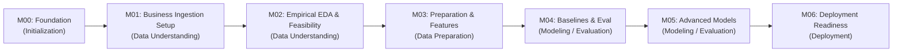

# Project Master Plan: Customer Purchase Propensity Prediction (T-ECD)

## 1. Project Overview & Objective

This project develops an end-to-end Machine Learning pipeline to predict **Customer Purchase Propensity** using the **T-ECD (Taobao / E-Commerce Dataset)**. The primary objective is to predict whether an active customer will make a purchase within a subsequent 7-day window based on their historical behavioral signals.

The project follows the standard **CRISP-DM (Cross-Industry Standard Process for Data Mining)** methodology across seven staged milestones (**M00–M06**). All architecture and execution decisions must respect the constraint of running on a **resource-constrained personal laptop** (e.g., 16 GB RAM, CPU-bound execution) without compromising statistical rigor, software quality, or data leakage prevention.

---

## 2. Milestone Roadmap & CRISP-DM Alignment

| Milestone | Milestone Name | CRISP-DM Phase | Target Outcome | Primary Output |
| :--- | :--- | :--- | :--- | :--- |
| **M00** | Project Initialization & Foundation Setup | Project Setup & Preliminary Business Understanding | Establish repository structure, contracts, plans, personal-machine execution rules, and three-party governance protocols | `docs/`, `pyproject.toml`, `README.md` |
| **M01** | Data Acquisition, Environment Provisioning & Ingestion Setup | Data Understanding (Business Scoping & Ingestion Setup) | Define business meaning of valid purchase, target objectives, eligibility policies, feature hypotheses, and configure safe ingestion mechanics | `src/data/`, Business Definitions, Feature Catalog |
| **M02** | Exploratory Data Analysis & Empirical Data Quality Assessment | Data Understanding (Empirical Profiling & Feasibility) | Inspect actual schema, validate event semantics/timestamps, assess feature availability, verify target constructibility, and evaluate sampling feasibility | `notebooks/`, `docs/DATA_QUALITY_ASSESSMENT.md`, Feasibility Report |
| **M03** | Data Preparation, Sampling Strategy & Feature Engineering | Data Preparation | Point-in-time correct snapshots, feature extraction, and zero-leakage chronological splits | `src/features/`, Leakage Verification Suite |
| **M04** | Baseline Modeling & Evaluation Strategy | Modeling & Evaluation (Phase 1) | Benchmarking simple heuristics & linear models under chronological validation | `src/models/`, Baseline Benchmark Report |
| **M05** | Advanced Modeling, Tuning & Error Analysis | Modeling & Evaluation (Phase 2) | Gradient boosting models, calibration, hyperparameter tuning, and error slicing | `src/models/`, SHAP/Interpretability Report |
| **M06** | Deployment Readiness & Pipeline Packaging | Deployment | Batch scoring inference pipeline, data drift guards, and final documentation | `src/inference/`, Final Delivery Report |

---

## 3. Governance & Decision Authority

All milestone transitions adhere to a strict **Three-Party Governance Protocol**:
1. **Antigravity (Implementer)**: Executes milestone tasks, enforces anti-leakage rules, runs validation checks, and submits the handoff report.
2. **ChatGPT (Independent Reviewer)**: Reviews submitted deliverables against objective milestone exit criteria and issues an advisory recommendation (`RECOMMEND_APPROVAL`, `RECOMMEND_REVISION`, `RECOMMEND_REJECT`).
3. **Project Owner (Final Decision Authority)**: Holds sole authority to approve milestone completion and authorize advancement. **No milestone may be marked `COMPLETED` nor may subsequent milestones begin without explicit Project Owner approval.**

---

## 4. Detailed Milestone Specifications

### M00 — Project Initialization & Foundation Setup
- **CRISP-DM Phase**: Project Setup & Preliminary Business Understanding
- **Objective**: Establish strict repository structure, governance documentation, dependency definitions, personal-computer execution policies, and the three-party approval workflow.
- **Deliverables**:
  - Exactly six root-level components: `docs/`, `notebooks/`, `src/`, `sample_data/`, `pyproject.toml`, `README.md`.
  - Comprehensive documentation suite inside `docs/` (`PROJECT_MASTER_PLAN.md`, `PROJECT_STATE.md`, `DECISION_LOG.md`, `MILESTONE_CHECKLIST.md`, `BUSINESS_UNDERSTANDING.md`, `DATA_CONTRACT.md`, `HANDOFF.md`).
  - Minimal `pyproject.toml` targeting Python 3.12 without premature dependencies or lockfiles.
- **Dependencies**: None.
- **Risks**: Over-engineering initial configuration; premature package installation; unverified assumptions treated as factual.
- **Acceptance Criteria**:
  1. Root directory strictly contains only the six allowed items (`.git` permitted as repository store).
  2. `pyproject.toml` parses successfully in Python 3.12.
  3. All documentation contains zero unpopulated placeholders.
  4. Assumptions log strictly demarcates verified facts from pending hypotheses.
  5. Personal-computer execution rules integrated (AD-007).
  6. Three-party governance with Project Owner approval authority established.
  7. Status set to `REVIEW_PENDING` in `docs/PROJECT_STATE.md`.

---

### M01 — Data Acquisition, Environment Provisioning & Ingestion Setup
- **CRISP-DM Phase**: Data Understanding (Business Scoping, Environment & Ingestion Mechanics)
- **Objective**: Establish business definitions and technical foundations for data understanding:
  1. Define the business meaning of a valid purchase (what constitutes an order vs. reservation vs. payment).
  2. Define target objectives and stakeholder expectations (conversion lift goals, precision thresholds).
  3. Establish preliminary customer eligibility policies (activity criteria for scoring).
  4. Record comprehensive feature hypotheses (recency, frequency, intensity, category affinity).
  5. Provision local Python 3.12 environment on personal machine with lightweight data processing tools.
  6. Implement reproducible raw data download and ingestion scripts with resource safety guards.
- **Deliverables**:
  - Business Definition of Valid Purchase and Target Formulation document.
  - Preliminary Customer Eligibility Policies.
  - Feature Hypotheses Catalog.
  - Provisioned Python 3.12 virtual environment (external to repo tree).
  - Reproducible ingestion script/module (`src/data/download.py` or `src/data/ingest.py`).
- **Dependencies**: Explicit Project Owner approval of M00.
- **Risks**:
  - Confusing business intent with empirical data realities before schema inspection.
  - Resource exhaustion if large raw archives are downloaded without pre-check.
- **Acceptance Criteria**:
  1. Business purchase semantics and target objectives formally documented.
  2. Customer eligibility rules and feature hypotheses cataloged.
  3. Local Python 3.12 environment functional with required initial tooling.
  4. Safe data retrieval script prepared with pre-download size checking.
  5. ChatGPT review recommendation obtained; Project Owner approval recorded before M02 starts.

---

### M02 — Exploratory Data Analysis (EDA) & Empirical Data Quality Assessment
- **CRISP-DM Phase**: Data Understanding (Empirical Profiling & Feasibility Verification)
- **Objective**: Empirically inspect and validate the physical T-ECD dataset against business assumptions:
  1. Inspect the actual dataset schema (column names, physical types, null rates, cardinality).
  2. Validate event semantics and timestamp coverage (verify raw event codes, timestamp ranges, clock anomalies).
  3. Assess feature availability (check whether hypothesized features can be calculated from actual data).
  4. Verify whether the proposed target can be constructed (confirm purchase event presence, frequency, and 7-day lookahead feasibility).
  5. Evaluate sampling feasibility (measure dataset size, evaluate subsampling methods to fit personal laptop memory).
- **Deliverables**:
  - Focused, reproducible Jupyter notebooks in `notebooks/`.
  - Comprehensive Data Quality Assessment in `docs/DATA_QUALITY_ASSESSMENT.md`.
  - Empirical Target Constructibility and Temporal Feasibility Report.
  - Verified Sampling Strategy specification for laptop scale.
- **Dependencies**: Explicit Project Owner approval of M01.
- **Risks**:
  - Memory exhaustion while computing global aggregates on large datasets.
  - Absence or ambiguity of critical behavioral columns.
  - Anomalous promotional bursts (e.g., 11.11 shopping festival) biasing general purchase dynamics.
- **Acceptance Criteria**:
  1. Actual dataset schema cataloged directly from raw files without speculation.
  2. Event semantics and timestamp spans empirically validated.
  3. Feature availability verified against M01 hypotheses.
  4. 7-day target constructibility confirmed without extreme class rarity.
  5. Sampling feasibility on 16 GB RAM laptop demonstrated.
  6. ChatGPT review recommendation obtained; Project Owner approval recorded before M03 starts.

---

### M03 — Data Preparation, Sampling Strategy & Feature Engineering
- **CRISP-DM Phase**: Data Preparation
- **Objective**: Construct point-in-time correct observation snapshots $(u_i, t_s)$ and label generation logic with zero future data leakage. Design a resource-efficient sampling strategy (e.g., active customer cohort subsampling) that fits personal laptop RAM. Engineer recency, frequency, engagement intensity, and category affinity features using historical events strictly prior to $t_s$.
- **Deliverables**:
  - Snapshot generation and chronological partitioning pipeline (`src/features/snapshots.py`).
  - Modular feature engineering library (`src/features/engineer.py`).
  - Automated temporal leakage verification test suite.
  - Chronologically split train, validation, and test datasets stored in Parquet format.
- **Dependencies**: Explicit Project Owner approval of M02.
- **Risks**:
  - Temporal lookahead leakage caused by non-strict timestamp joins.
  - Unintended selection bias introduced during user sampling.
  - High RAM usage during historical aggregation across multiple lookback windows.
- **Acceptance Criteria**:
  1. Zero lookahead leakage confirmed via automated tests asserting $t_{\text{event}} \le t_{\text{snapshot}}$.
  2. Dataset split strictly chronologically (Train $T_0 \to T_1$, Validation $T_1 \to T_2$, Test $T_2 \to T_3$).
  3. Complete feature extraction pipeline executes within laptop memory limits.
  4. Feature metadata and dictionary documented in `docs/FEATURE_STORE.md`.
  5. ChatGPT review recommendation obtained; Project Owner approval recorded before M04 starts.

---

### M04 — Baseline Modeling & Evaluation Strategy
- **CRISP-DM Phase**: Modeling & Evaluation (Phase 1)
- **Objective**: Formulate the primary evaluation framework aligned with business goals (ranking and calibrated probabilities under class imbalance). Implement heuristic baselines (e.g., most recent cart-add, frequency heuristic) and a baseline statistical model (Logistic Regression / Decision Tree). Establish performance floors.
- **Deliverables**:
  - Metric evaluation module (`src/evaluation/metrics.py`) computing PR-AUC, ROC-AUC, Brier score, and Precision@Top-K.
  - Baseline model pipelines (`src/models/baseline.py`).
  - Baseline evaluation benchmark report in `docs/BASELINE_REPORT.md`.
- **Dependencies**: Explicit Project Owner approval of M03.
- **Risks**:
  - Misleading metrics (e.g., accuracy paradox on imbalanced conversion data).
  - Data leakage inside cross-validation loops (e.g., improper scaling or imputation across temporal splits).
- **Acceptance Criteria**:
  1. Evaluation framework enforces chronological evaluation (train on past, evaluate on future).
  2. At least two baseline approaches benchmarked and documented.
  3. PR-AUC, ROC-AUC, Precision@K, and Calibration (Brier Score) established as formal benchmarks.
  4. ChatGPT review recommendation obtained; Project Owner approval recorded before M05 starts.

---

### M05 — Advanced Modeling, Hyperparameter Optimization & Error Analysis
- **CRISP-DM Phase**: Modeling & Evaluation (Phase 2)
- **Objective**: Develop high-performance Gradient Boosted Decision Tree models (e.g., LightGBM / CatBoost) optimized for tabular behavioral data. Perform disciplined hyperparameter tuning with temporal validation, probability calibration (Isotonic / Platt), feature attribution (SHAP), and sub-population error analysis.
- **Deliverables**:
  - Production-grade training and tuning modules (`src/models/train.py`, `src/models/tune.py`).
  - Model calibration module (`src/models/calibrate.py`).
  - Feature importance and SHAP interpretability report in `docs/MODEL_INTERPRETABILITY.md`.
  - Slice/cohort error analysis report in `docs/ERROR_ANALYSIS.md`.
- **Dependencies**: Explicit Project Owner approval of M04.
- **Risks**:
  - Overfitting to specific temporal anomalies in the training window.
  - Excessive compute/memory footprint during grid or Bayesian hyperparameter searches.
  - Poor probability calibration leading to unreliable thresholding for marketing interventions.
- **Acceptance Criteria**:
  1. Advanced model demonstrates statistically significant improvement over M04 baselines.
  2. Predicted probabilities demonstrate verified calibration on the test split.
  3. Feature attributions align with domain logic without revealing leakage artifacts.
  4. Model training completes within reasonable personal laptop runtimes (e.g., < 30 minutes).
  5. ChatGPT review recommendation obtained; Project Owner approval recorded before M06 starts.

---

### M06 — Deployment Readiness, Inference Pipeline & Project Packaging
- **CRISP-DM Phase**: Deployment
- **Objective**: Package the trained model into a robust batch inference pipeline capable of scoring a new customer snapshot batch. Implement input schema validation, anomaly guards, propensity decile binning, and comprehensive operational documentation.
- **Deliverables**:
  - Batch inference script (`src/inference/predict_batch.py`).
  - Automated integration test covering end-to-end inference from raw snapshot to scored predictions.
  - Monitoring and data drift specification in `docs/MONITORING_PLAN.md`.
  - Final project delivery report and comprehensive handoff documentation in `docs/FINAL_DELIVERY_REPORT.md`.
- **Dependencies**: Explicit Project Owner approval of M05.
- **Risks**:
  - Pipeline failure on unexpected nulls, missing categorical values, or schema variations at inference.
  - Resource exhaustion when scoring full user populations.
- **Acceptance Criteria**:
  1. End-to-end batch scoring pipeline executes reliably from command-line interface.
  2. Input schema validation halts execution gracefully on malformed inputs.
  3. Predictions include calibrated probabilities and decile bucket assignments.
  4. Final repository and documentation packaged cleanly for stakeholder review.
  5. Final project sign-off granted by Project Owner.

---

## 5. Multi-Faceted Temporal Architecture

Temporal feasibility cannot be established through speculative duration numbers (such as an assumed 28–30 day minimum). Instead, temporal modeling design requires balancing six independent operational and statistical components:

1. **Observation Window**: Historical lookback duration ($t \le t_s$) required to compute robust behavioral recency, frequency, and affinity features.
2. **Prediction Horizon**: Exactly 7 calendar days post-snapshot $(t_s, t_s + 7\text{d}]$ over which target purchases are evaluated.
3. **Feature Availability Gap / Ingestion Lag**: Buffer between real-time event logging and snapshot calculation time.
4. **Snapshot Frequency / Stride**: Cadence separating successive snapshot cohorts (e.g., daily vs. weekly).
5. **Label Maturity Window**: Period required for the 7-day target outcome to definitively materialize and settle before labels are consumed for training.
6. **Temporal Validation Periods**: Independent chronological partitions for training, validation, and testing separated by maturity buffers.

> [!IMPORTANT]
> **Empirical Gate**: The exact feasibility of these temporal components will be determined strictly after inspecting the actual timestamp coverage and duration of the dataset in **M02**.

---

## 6. Personal Laptop Constraints & Efficiency Guardrails

| Constraint Dimension | Personal Laptop Limitation | Architectural Strategy |
| :--- | :--- | :--- |
| **RAM** | 16 GB Physical Memory | Streaming reads, Polars lazy execution, Parquet columnar storage with dictionary encoding. |
| **CPU** | 4–8 cores, no high-end GPU | Tree-based models (LightGBM) optimized for multi-threaded CPU execution; avoid heavy neural sequences. |
| **Disk Space** | < 50 GB free working space | Intermediate files cleaned; compressed Parquet files (`zstd` / `snappy`); resource-efficient sampling. |
| **Virtual Environments** | Local personal workstation | Virtual environments (`.venv`), package caches, and temporary artifacts kept outside repository root where practical to preserve clean 6-root structure. |
| **Sampling Strategy** | Full dataset cannot be held in memory uncompressed | Active customer cohort sampling and stratified negative sampling designed and verified in M02/M03. |
