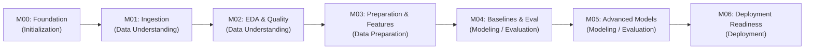

# Project Master Plan: Customer Purchase Propensity Prediction (T-ECD)

## 1. Project Overview & Objective

This project develops an end-to-end Machine Learning pipeline to predict **Customer Purchase Propensity** using the **T-ECD (Taobao / E-Commerce Dataset)**. The primary objective is to predict whether an active customer will make a purchase within a subsequent 7-day window based on their historical behavioral signals.

The project follows the standard **CRISP-DM (Cross-Industry Standard Process for Data Mining)** methodology across seven staged milestones (**M00–M06**). All architecture and execution decisions must respect the constraint of running on a **resource-constrained personal laptop** (e.g., 16 GB RAM, CPU-bound execution) without compromising statistical rigor, software quality, or data leakage prevention.

---

## 2. Milestone Roadmap & CRISP-DM Alignment

| Milestone | Milestone Name | CRISP-DM Phase | Target Outcome | Primary Output |
| :--- | :--- | :--- | :--- | :--- |
| **M00** | Project Initialization & Foundation Setup | Project Setup & Preliminary Business Understanding | Establish repository structure, contracts, plans, and review protocols | `docs/`, `pyproject.toml`, `README.md` |
| **M01** | Data Acquisition & Ingestion Setup | Data Understanding (Collection & Inspection) | Ingest raw T-ECD data safely on personal laptop with verified integrity | `src/data/`, `sample_data/`, Schema Report |
| **M02** | Exploratory Data Analysis & Data Quality | Data Understanding (Exploration & Quality) | Discover behavioral patterns, data anomalies, distributions, and eligibility rules | `notebooks/`, Data Quality Audit Report |
| **M03** | Data Preparation, Sampling & Feature Engineering | Data Preparation | Point-in-time correct snapshots, feature extraction, and zero-leakage splits | `src/features/`, Leakage Verification Suite |
| **M04** | Baseline Modeling & Evaluation Strategy | Modeling & Evaluation (Phase 1) | Benchmarking simple heuristics & linear models under chronological validation | `src/models/`, Baseline Benchmark Report |
| **M05** | Advanced Modeling, Tuning & Error Analysis | Modeling & Evaluation (Phase 2) | Gradient boosting models, calibration, hyperparameter tuning, and error slicing | `src/models/`, SHAP/Interpretability Report |
| **M06** | Deployment Readiness & Pipeline Packaging | Deployment | Batch scoring inference pipeline, data drift guards, and final documentation | `src/inference/`, Final Handoff Package |

---

## 3. Detailed Milestone Specifications

### M00 — Project Initialization & Foundation Setup
- **CRISP-DM Phase**: Project Setup & Preliminary Business Understanding
- **Objective**: Establish strict repository structure, governance documentation, dependency definitions, and the Antigravity $\leftrightarrow$ ChatGPT dual-agent review workflow.
- **Deliverables**:
  - Exactly six root-level components: `docs/`, `notebooks/`, `src/`, `sample_data/`, `pyproject.toml`, `README.md`.
  - Comprehensive documentation suite inside `docs/` (`PROJECT_MASTER_PLAN.md`, `PROJECT_STATE.md`, `DECISION_LOG.md`, `MILESTONE_CHECKLIST.md`, `BUSINESS_UNDERSTANDING.md`, `DATA_CONTRACT.md`, `HANDOFF.md`).
  - Minimal `pyproject.toml` targeting Python 3.12 without premature dependencies or lockfiles.
- **Dependencies**: None.
- **Risks**: Over-engineering initial configuration; premature package installation; unverified assumptions treated as factual.
- **Acceptance Criteria**:
  1. Root directory strictly contains only the six allowed items.
  2. `pyproject.toml` parses successfully in Python 3.12.
  3. All documentation contains zero unpopulated placeholders.
  4. Assumptions log strictly demarcates verified facts from pending hypotheses.
  5. Status set to `REVIEW_PENDING` in `docs/PROJECT_STATE.md`.

---

### M01 — Data Acquisition, Environment Provisioning & Ingestion Setup
- **CRISP-DM Phase**: Data Understanding (Data Collection & Initial Inspection)
- **Objective**: Set up Python 3.12 virtual environment, download or connect the T-ECD dataset, inspect raw file headers/types, verify data integrity via checksums, and extract a minimal representative sample for `sample_data/`.
- **Deliverables**:
  - Virtual environment specification and documented activation procedure.
  - Reproducible ingestion script/module (`src/data/download.py` or `src/data/ingest.py`).
  - Raw metadata and schema audit report in `docs/DATA_AUDIT_REPORT.md`.
  - Offline micro-sample files in `sample_data/` (committed or generated on-demand).
- **Dependencies**: Approval and completion of M00.
- **Risks**:
  - Dataset download bandwidth or host unavailability.
  - Storage consumption exceeding laptop capacity.
  - File encoding or delimiter anomalies.
- **Acceptance Criteria**:
  1. Environment activated with Python 3.12; essential dependencies installed.
  2. Raw data files downloaded and checksum-verified.
  3. Raw columns, record counts, and byte sizes cataloged without memory exhaustion.
  4. Representative micro-dataset created in `sample_data/` for unit testing and local development.

---

### M02 — Exploratory Data Analysis (EDA) & Data Quality Assessment
- **CRISP-DM Phase**: Data Understanding (Data Exploration & Quality Audit)
- **Objective**: Execute comprehensive statistical profiling of user behaviors (clicks, item views, cart additions, purchases), item categories, and temporal patterns. Identify missing values, duplicate events, out-of-order timestamps, and class balance. Validate the 7-day purchase propensity window.
- **Deliverables**:
  - Focused, reproducible Jupyter notebooks in `notebooks/`.
  - Comprehensive Data Quality Assessment in `docs/DATA_QUALITY_ASSESSMENT.md`.
  - Empirical verification of the 7-day prediction horizon viability.
  - Formal customer eligibility criteria (e.g., minimum activity threshold).
- **Dependencies**: Approval and completion of M01.
- **Risks**:
  - Memory exhaustion while computing global aggregates on large datasets.
  - High user/item cardinality distorting standard visual tools.
  - Anomalous promotional bursts (e.g., 11.11 shopping festival) biasing general purchase dynamics.
- **Acceptance Criteria**:
  1. Notebooks execute smoothly on laptop using Polars/DuckDB lazy execution.
  2. Statistical distribution of interaction types, session frequencies, and conversion rates documented.
  3. Data quality issues (nulls, duplicates, clock drift) quantified.
  4. Customer eligibility filtering rules documented and approved.

---

### M03 — Data Preparation, Sampling Strategy & Feature Engineering
- **CRISP-DM Phase**: Data Preparation
- **Objective**: Construct point-in-time correct observation snapshots $(u_i, t_s)$ and label generation logic with zero future data leakage. Design a resource-efficient sampling strategy (e.g., active customer cohort subsampling) that fits personal laptop RAM. Engineer recency, frequency, engagement intensity, and category affinity features using historical events strictly prior to $t_s$.
- **Deliverables**:
  - Snapshot generation and chronological partitioning pipeline (`src/features/snapshots.py`).
  - Modular feature engineering library (`src/features/engineer.py`).
  - Automated temporal leakage verification test suite.
  - Chronologically split train, validation, and test datasets stored in Parquet format.
- **Dependencies**: Approval and completion of M02.
- **Risks**:
  - Temporal lookahead leakage caused by non-strict timestamp joins.
  - Unintended selection bias introduced during user sampling.
  - High RAM usage during historical aggregation across multiple lookback windows (e.g., 1d, 3d, 7d, 30d).
- **Acceptance Criteria**:
  1. Zero lookahead leakage confirmed via automated tests asserting $t_{\text{event}} \le t_{\text{snapshot}}$.
  2. Dataset split strictly chronologically (Train $T_0 \to T_1$, Validation $T_1 \to T_2$, Test $T_2 \to T_3$).
  3. Complete feature extraction pipeline executes within laptop memory limits.
  4. Feature metadata and dictionary documented in `docs/FEATURE_STORE.md`.

---

### M04 — Baseline Modeling & Evaluation Strategy
- **CRISP-DM Phase**: Modeling & Evaluation (Phase 1)
- **Objective**: Formulate the primary evaluation framework aligned with business goals (ranking and calibrated probabilities under class imbalance). Implement heuristic baselines (e.g., most recent cart-add, frequency heuristic) and a baseline statistical model (Logistic Regression / Decision Tree). Establish performance floors.
- **Deliverables**:
  - Metric evaluation module (`src/evaluation/metrics.py`) computing PR-AUC, ROC-AUC, Brier score, and Precision@Top-K.
  - Baseline model pipelines (`src/models/baseline.py`).
  - Baseline evaluation benchmark report in `docs/BASELINE_REPORT.md`.
- **Dependencies**: Approval and completion of M03.
- **Risks**:
  - Misleading metrics (e.g., accuracy paradox on imbalanced conversion data).
  - Data leakage inside cross-validation loops (e.g., improper scaling or imputation across temporal splits).
- **Acceptance Criteria**:
  1. Evaluation framework enforces chronological evaluation (train on past, evaluate on future).
  2. At least two baseline approaches benchmarked and documented.
  3. PR-AUC, ROC-AUC, Precision@K, and Calibration (Brier Score) established as formal benchmarks.

---

### M05 — Advanced Modeling, Hyperparameter Optimization & Error Analysis
- **CRISP-DM Phase**: Modeling & Evaluation (Phase 2)
- **Objective**: Develop high-performance Gradient Boosted Decision Tree models (e.g., LightGBM / CatBoost) optimized for tabular behavioral data. Perform disciplined hyperparameter tuning with temporal validation, probability calibration (Isotonic / Platt), feature attribution (SHAP), and sub-population error analysis.
- **Deliverables**:
  - Production-grade training and tuning modules (`src/models/train.py`, `src/models/tune.py`).
  - Model calibration module (`src/models/calibrate.py`).
  - Feature importance and SHAP interpretability report in `docs/MODEL_INTERPRETABILITY.md`.
  - Slice/cohort error analysis report in `docs/ERROR_ANALYSIS.md`.
- **Dependencies**: Approval and completion of M04.
- **Risks**:
  - Overfitting to specific temporal anomalies in the training window.
  - Excessive compute/memory footprint during grid or Bayesian hyperparameter searches.
  - Poor probability calibration leading to unreliable thresholding for marketing interventions.
- **Acceptance Criteria**:
  1. Advanced model demonstrates statistically significant improvement over M04 baselines.
  2. Predicted probabilities demonstrate verified calibration on the test split.
  3. Feature attributions align with domain logic without revealing leakage artifacts.
  4. Model training completes within reasonable personal laptop runtimes (e.g., < 30 minutes).

---

### M06 — Deployment Readiness, Inference Pipeline & Project Packaging
- **CRISP-DM Phase**: Deployment
- **Objective**: Package the trained model into a robust batch inference pipeline capable of scoring a new customer snapshot batch. Implement input schema validation, anomaly guards, propensity decile binning, and comprehensive operational documentation.
- **Deliverables**:
  - Batch inference script (`src/inference/predict_batch.py`).
  - Automated integration test covering end-to-end inference from raw snapshot to scored predictions.
  - Monitoring and data drift specification in `docs/MONITORING_PLAN.md`.
  - Final project delivery report and comprehensive handoff documentation in `docs/FINAL_DELIVERY_REPORT.md`.
- **Dependencies**: Approval and completion of M05.
- **Risks**:
  - Pipeline failure on unexpected nulls, missing categorical values, or schema variations at inference.
  - Resource exhaustion when scoring full user populations.
- **Acceptance Criteria**:
  1. End-to-end batch scoring pipeline executes reliably from command-line interface.
  2. Input schema validation halts execution gracefully on malformed inputs.
  3. Predictions include calibrated probabilities and decile bucket assignments.
  4. Final repository and documentation packaged cleanly for stakeholder review.

---

## 4. Hardware Constraints & Efficiency Guardrails

| Constraint Dimension | Personal Laptop Limitation | Architectural Strategy |
| :--- | :--- | :--- |
| **RAM** | 16 GB Physical Memory | Streaming reads, Polars lazy execution, Parquet columnar storage with dictionary encoding. |
| **CPU** | 4–8 cores, no high-end GPU | Tree-based models (LightGBM) optimized for multi-threaded CPU execution; avoid deep sequence architectures unless proven necessary. |
| **Disk Space** | < 50 GB free working space | Intermediate files cleaned; compressed Parquet files (`zstd` / `snappy`); resource-efficient sampling. |
| **Sampling Strategy** | Full dataset cannot be held in memory uncompressed | Active customer cohort sampling and stratified negative sampling designed in M02/M03. |

