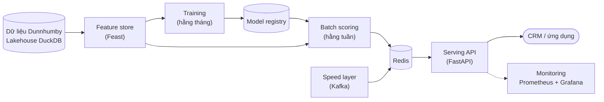
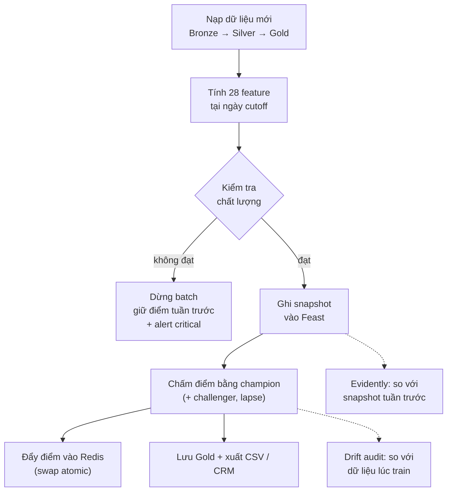
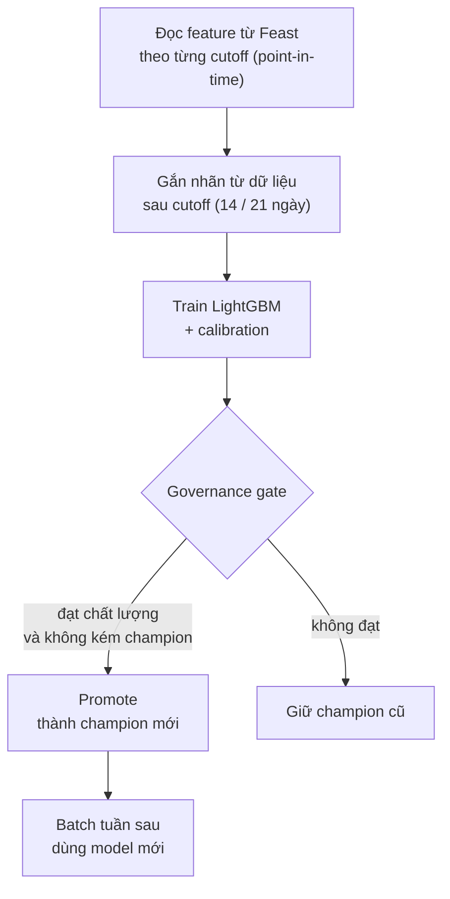
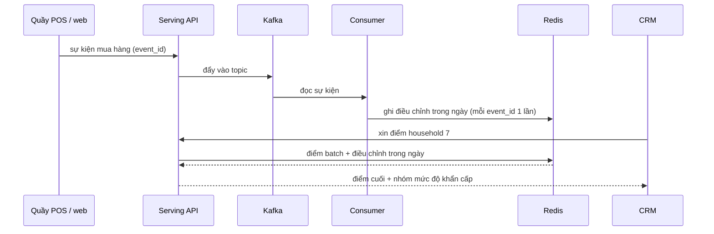
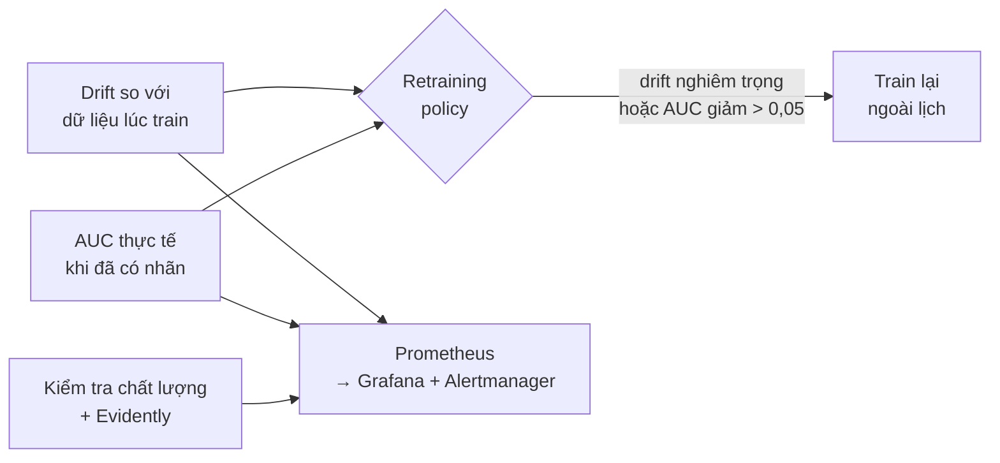

# Kiến trúc hệ thống

Đọc từ trên xuống: sơ đồ 1 là bức tranh tổng thể; các sơ đồ 2–5 đi vào từng luồng.
Mỗi sơ đồ chỉ trả lời một câu hỏi.

## 1. Tổng quan: hệ thống gồm những khối nào?

| Khối | Làm gì |
|---|---|
| Lakehouse | Nạp CSV, làm sạch theo các lớp Bronze → Silver → Gold, lưu điểm batch |
| Feature store | Lưu lịch sử 28 feature của từng household theo mỗi ngày cutoff |
| Training | Train LightGBM; chỉ promote nếu model mới qua governance gate |
| Batch scoring | Mỗi tuần chấm điểm toàn bộ household rồi đẩy vào Redis |
| Speed layer | Nhận sự kiện mua hàng trong ngày, điều chỉnh điểm ngay |
| Serving API | Trả điểm = điểm batch + điều chỉnh trong ngày |
| Monitoring | Drift, AUC thực tế, cảnh báo, dashboard |

## 2. Mỗi tuần: điểm số được tạo ra như thế nào?

Đường liền là luồng chính. Đường nét đứt chỉ để quan sát: nếu lỗi thì batch vẫn chạy tiếp.

## 3. Mỗi tháng: model mới được train và promote như thế nào?

Governance gate kiểm tra 2 điều:
1. Chất lượng tuyệt đối: AUC, Brier, lift, ECE vượt ngưỡng.
2. Không kém champion hiện tại: kiểm định bằng bootstrap.

Hai model chạy song song là `purchase` (mua trong 14 ngày tới) và `lapse` (khách quen sắp rời bỏ, 21 ngày).

## 4. Khi có request: API trả điểm như thế nào?

Ví dụ: household vừa mua sáng nay thì xác suất mua thêm trong vài ngày tới bị giảm xuống (dampening).
Household chưa có điểm batch thì nhận điểm mặc định (cold start).

## 5. Làm sao biết model đang xuống cấp?

| Câu hỏi | Công cụ |
|---|---|
| Dữ liệu tuần này có hỏng không? | Kiểm tra chất lượng: chặn batch nếu dữ liệu xấu |
| Snapshot này khác tuần trước bao nhiêu? | Evidently: báo cáo HTML + Grafana |
| Dữ liệu có khác lúc train không? | Drift audit (PSI, KS) |
| Model còn dự đoán đúng không? | Feedback loop (AUC thực tế) |

## Lịch chạy

| Job | Khi nào |
|---|---|
| Kiểm tra chất lượng Lakehouse | Hằng ngày 01:00 |
| Batch scoring | Thứ Hai 02:00 |
| Feedback (AUC thực tế) | Thứ Tư 04:00 |
| Train lại | Ngày 1 hằng tháng 03:00, hoặc khi retraining policy yêu cầu |
