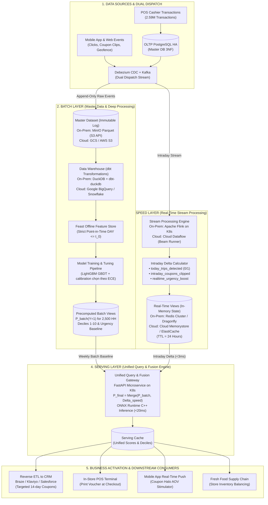

# ⚡ KIẾN TRÚC LAMBDA CHO HỆ THỐNG ML DỰ ĐOÁN XÁC SUẤT MUA HÀNG

> **Lưu ý (2026-11-23):** đây là tài liệu *thiết kế mục tiêu* (gồm Flink/Beam, dbt, MinIO). Phần đang chạy thật trong repo được mô tả ở [README](../../README.md) và [RUNBOOK](../RUNBOOK.md): speed layer dùng Kafka consumer + Redis, lakehouse là DuckDB với lớp Bronze ingest từ CSV, không dùng MinIO/Postgres.
### Enterprise Lambda Architecture for Household Purchase Propensity Platform
**Chiến Lược: Xây Dựng On-Premise Trước $\to$ Di Chuyển Mượt Mà Lên Cloud (Zero-Downtime Migration)**
*Bộ Dữ Liệu Thực Nghiệm: Dunnhumby - The Complete Journey (2.595.732 giao dịch, 2.500 hộ gia đình, 711 ngày, 8 bảng)*

---

## 🎯 1. Tại Sao Phải Áp Dụng Lambda Architecture Cho Bài Toán Propensity?

Bài toán **Household Purchase Propensity** (Dự đoán xác suất hộ gia đình phát sinh giao dịch trong 7–14 ngày tới) sở hữu hai đặc tính nghiệp vụ đối nghịch mà các kiến trúc đơn lẻ (thuần Batch hoặc thuần Streaming) không thể giải quyết trọn vẹn:

1. **Độ sâu lịch sử (Depth of History - Cần Batch Layer)**:
   - Để dự báo chính xác, mô hình LightGBM cần 23 đặc trưng phức tạp tính toán trên cửa sổ trượt dài: tổng chi tiêu 180 ngày, tần suất 90 ngày, chu kỳ mua trung bình (`avg_inter_trip_days`), độ lệch chuẩn chu kỳ (`std_inter_trip`), và chỉ số trung thành cửa hàng (`store_loyalty_index`).
   - Việc tính toán này trên 2.6 triệu dòng dữ liệu đòi hỏi sức mạnh xử lý khối lượng lớn (Batch OLAP Engine: DuckDB / BigQuery). Thuần streaming không thể lưu trữ và join cửa sổ 180 ngày với chi phí hợp lý và độ trễ thấp.
2. **Độ nhạy thời gian thực (Real-Time Reactivity - Cần Speed Layer)**:
   - Nếu chỉ dựa vào Batch hàng tuần, hệ thống sẽ gặp hiện tượng **Stale Propensity (Điểm số bị trễ)**: Giả sử một khách hàng thuộc Top Decile (xác suất mua $98\%$) vừa ghé siêu thị và thanh toán một giỏ hàng lớn (\$150) cách đây 15 phút. Nếu không có Speed Layer, hệ thống vẫn tiếp tục gửi tin nhắn SMS / Push thông báo coupon mời họ đi chợ, gây lãng phí ngân sách tiếp thị và trải nghiệm khách hàng tệ.
   - Speed Layer thu nhận biên lai POS và sự kiện app ngay lập tức, tính toán **Delta Features**, lập tức reset `recency_days = 0` hoặc gia tăng `urgency_multiplier` khi khách vừa lưu voucher đồ tươi.

> **Giải pháp Lambda Architecture**:
> - **Batch Layer**: Duy trì Master Dataset bất biến, định kỳ tính toán các đặc trưng sâu và điểm số cơ sở ($P_{\text{batch}}$).
> - **Speed Layer**: Xử lý dòng sự kiện trong ngày (Intraday stream), tính toán các độ lệch tức thời ($\Delta_{\text{speed}}$).
> - **Serving Layer**: Hợp nhất thông minh ($P_{\text{serving}} = \text{Merge}(P_{\text{batch}}, \Delta_{\text{speed}})$) phục vụ các kênh tiêu thụ với độ trễ P99 $< 25\text{ms}$.

---

## 🗺️ 2. Sơ Đồ Kiến Trúc Tổng Thể (Mermaid Architecture Diagram)

---

## 🏛️ 3. Chi Tiết Từng Phân Hệ Lambda Architecture

### 3.1. Data Ingestion & Dual Dispatch (Cổng Thu Nhận & Phân Luồng)
- **Giao dịch OLTP POS**: Được lưu trữ tại cụm PostgreSQL 16 theo chuẩn 3NF: Bảng `transactions` (2.59M dòng) có B-tree index `(household_key, DAY)`, phân vùng theo thời gian.
- **Phân Luồng Kép (Dual Dispatch via Debezium CDC + Kafka)**:
  - Nhánh 1 (Batch): Ghi append-only vào MinIO Object Store (S3 API) dưới dạng Parquet ZSTD.
  - Nhánh 2 (Speed): Đẩy sự kiện tức thời vào topic Kafka phục vụ stream processing.

### 3.2. Batch Layer (Tầng Lô - Master Dataset & Xử Lý Sâu)
- **Master Dataset**: CSV thô mount chỉ-đọc, được ingest thành Parquet lớp Bronze (DuckDB Lakehouse). *(Thiết kế mục tiêu: MinIO / S3 object store.)*
- **Data Warehouse & Transformations**: DuckDB xử lý dữ liệu phân tích cực nhanh, tổ chức mô hình dbt 3 tầng (`staging`, `intermediate`, `marts`).
- **Feature Store Offline**: Kỷ luật Point-In-Time tuyệt đối ($DAY \le t_0$, Zero Future Leakage), trích xuất 28 đặc trưng multi-domain theo feature contract `multidomain_v1`.
- **Mô Hình Champion**: LightGBM với Isotonic calibration, hai target: `purchase` 14 ngày (OOT AUC 0,859) và `lapse` 21 ngày (OOT AUC 0,816). Xem [MODEL_CARD.md](../MODEL_CARD.md).

### 3.3. Speed Layer (Tầng Tốc Độ / Stream Processing)
- **Engine**: Apache Flink / Beam streaming processor.
- **Tính toán Delta Features**: Cờ `intraday_trips_detected`, số mã `intraday_coupons_clipped`, thời gian duyệt app.
- **Real-Time Views**: Redis Cluster lưu vector delta với TTL 24 giờ, tự động reset khi Batch hoàn tất.

### 3.4. Serving Layer (Tầng Phục Vụ Hợp Nhất)
- **FastAPI Unified Fusion Gateway**:
  $$\text{Propensity}_{\text{Serving}}(h) = \text{MergeFunction}(\text{BatchView}(h), \text{RealTimeView}(h))$$
  - Nếu đã mua hôm nay: Recency reset về 0, giảm ưu tiên coupon để tránh lãng phí.
  - Nếu vừa lưu coupon đồ tươi: Tăng hệ số khẩn cấp (Urgency).
  - P99 Latency $< 25\text{ms}$ qua Redis serving cache.

---

## ☁️ 4. Ma Trận Đối Chiếu Công Nghệ On-Premise $\to$ Cloud

| Tầng Lambda | On-Premise Stack (Phase 1) | Cloud Target (GCP / AWS) (Phase 2) | Cơ Chế Di Chuyển |
|---|---|---|---|
| **Master Dataset** | MinIO Object Store (S3 API) | Google Cloud Storage (GCS) / AWS S3 | S3 API compatible; `rclone` / Storage Transfer. |
| **OLTP Database** | PostgreSQL HA (Patroni) | Cloud SQL for PostgreSQL / Aurora | PostgreSQL Logical Replication. |
| **Streaming Broker**| Debezium + Apache Kafka | Cloud Pub/Sub / Confluent Cloud | Kafka MirrorMaker 2 replication. |
| **Data Warehouse** | DuckDB + dbt-duckdb | Google BigQuery / Snowflake | Chỉ đổi `dbt-duckdb` sang `dbt-bigquery`. |
| **Speed Engine** | Apache Flink on Kubernetes | Google Cloud Dataflow (Beam) | Apache Beam Python SDK runner switch. |
| **Real-Time View** | Redis Cluster / Dragonfly | Cloud Memorystore / ElastiCache | 100% tương thích giao thức Redis. |
| **Serving API** | FastAPI + Triton on K8s | Google Kubernetes Engine (GKE) | Docker image & Helm chart tái sử dụng 100%. |
| **Model Registry** | MLflow Server + MinIO | Managed MLflow / Vertex AI | Đổi `MLFLOW_TRACKING_URI`. |
